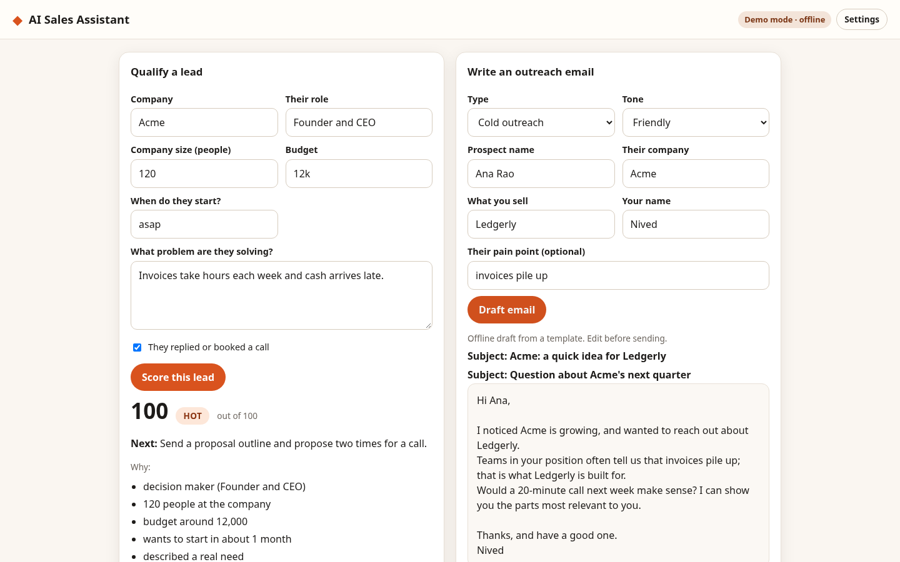

# AI Sales Assistant

Score a lead with a visible rule set, get the next step, and draft outreach in one tone.



## Features

- Lead qualification: a 0-100 score from role, company size, budget, timeline, stated need and engagement, with the reasons and the missing questions listed
- Hot, warm and cold tiers with one concrete next step for each
- Outreach emails for cold outreach, follow-up, after a demo and a last-note breakup, in friendly, formal or direct tone
- Budget reading that understands $5k, 2.5 lakh and 1.2m; timeline reading for asap, this quarter or 6 months
- Copy button for the drafted email
- Demo mode works offline with templates; live mode asks your OpenAI-compatible endpoint for a second view and a model-written email

## Quick start

```bash
git clone https://github.com/connectnived-lab/ai-sales-assistant
cd ai-sales-assistant
python3 -m http.server 8080
# open http://localhost:8080
```

Or open `index.html` in a browser. No build step and no runtime dependencies.

Fill in what you know about the lead and press "Score this lead". Then fill in the prospect and press "Draft email". Blank fields are reported, not guessed.

## Demo and live modes

Demo mode is the default. It runs fully offline with deterministic logic and needs no key.

Live mode: open Settings, choose "Live", enter the base URL, key and model. The score stays rule-based and transparent; the model adds a two-sentence view and writes the email from the facts you entered.

Settings are stored only in your browser's localStorage. They are never committed and are sent only to the endpoint you enter.

## Tests

```bash
npm test     # node --test unit tests; LLM calls are mocked through an injectable fetch
npm run e2e  # Playwright smoke test (python3 + local Chromium) at 390x844 and 1440x900
```

The e2e script serves the app locally, runs the main flow in demo mode and again against a mocked OpenAI-compatible endpoint, and checks that results appear, that there are no console errors, and that the page does not scroll horizontally. Unit tests cover scoring tiers, budget and timeline parsing, email templates and prompt building; Playwright flows run at both viewports.

## Limitations

- The score is a transparent rule set, not a trained model, and it is only as good as the answers entered.
- Email drafts are templates offline; they use only the details entered, but always read them before sending.
- Nothing is sent: the app drafts and copies, it does not connect to a mailbox or CRM.
- Nothing is stored between visits.

## Project layout

```
src/core/   pure logic (scoring, budget and timeline parsing, email templates, prompts, settings, LLM client) - no DOM
src/ui/     DOM helpers and the settings panel
src/app.js  wiring between the UI and core
tests/unit  node:test suites
tests/e2e   Playwright smoke test
```

## Licence and credit

MIT License. Copyright (c) 2026 Nived NS.

Created and owned by Nived NS - https://github.com/connectnived-lab

Built by Nived NS
